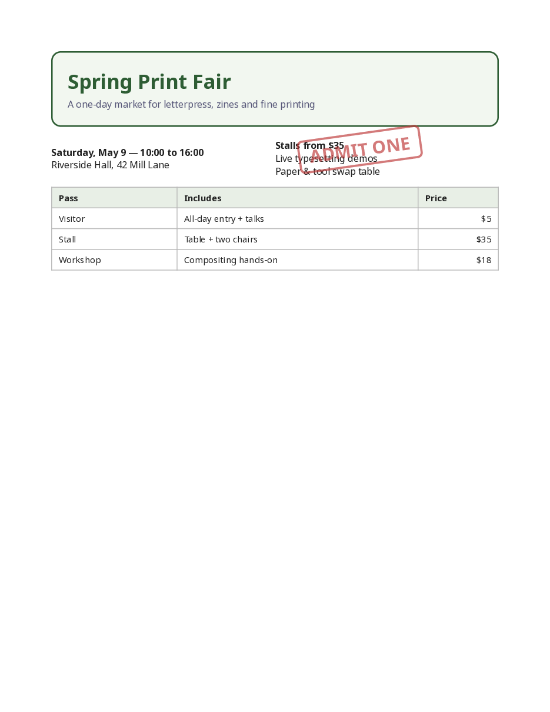

# weasyprint-ts

A from-scratch TypeScript port of [WeasyPrint 70.0](https://github.com/Kozea/WeasyPrint):
HTML + CSS in, paginated PDF out, **pixel-exact** against the original. Not a
wrapper, not a bridge, not a browser with the pixels checked afterwards — every
stage (CSS parsing → cascade → box tree → layout → shaping → drawing → PDF)
is ported file-by-file from Python into JavaScript, with no native code: no
Pango, no HarfBuzz, no FontConfig, no C.

"Pixel-exact" is earned, not asserted. Every commit is measured against the
real thing — the actual Python WeasyPrint, running in a pinned Linux
environment — by rendering the same documents side by side and comparing:

- the PDF structure (objects, dictionaries, extracted text, attachments),
- page geometry and page counts,
- the rendered pixels at 96 dpi — currently **zero differing pixels**.

The corpus comes from upstream's own test suite (~3,000 documents: extracts,
plus captures of what upstream's tests really render), and every commit is
scored against it. The handful of residual discrepancies are documented in
the issue tracker, down to the last antialiasing pixel.

```
weasyprint-ts -s style.css flyer.html flyer.pdf
```

## Status

Same scoring rules as everywhere else in this project: a case is either
indistinguishable from the oracle (pixels, PDF structure, page counts) or it
isn't and it goes to the tracker.

| Area | State |
|---|---|
| HTML parsing, CSS cascade, computed styles | done |
| Layout: block, inline, tables, flex, floats, grid, columns, pagination | done |
| Absolute positioning, transforms, opacity, @page + margin boxes, string-set | done |
| Text: font matching, shaping, line breaking, hyphenation, soft hyphens, decorations | done (HarfBuzz normalization, script shapers, fallback marks) |
| Images: PNG, GIF, BMP, TIFF, WebP decode; JPEG decode (grayscale, RGB, CMYK/YCCK, every libjpeg subsampling, baseline and progressive) and Pillow-identical re-encode | done |
| Backgrounds, borders, shadows, gradients | done |
| Inline SVG, first-class (upstream SVG slices 0–11) | done |
| PDF variants, PDF/A · UA · X, tagged PDF, forms, attachments, bookmarks, links, page boxes/labels | done (structure: 78/78 + PDF/X 4/4) |
| CLI drop-in: `-s -a -p -e -m -u -D -j --pdf-variant …` | done, `--help` byte-identical |

## Install

```sh
npm install weasyprint-ts
npm link weasyprint-ts   # optional: puts `weasyprint-ts` on your PATH
```

Requires Node >= 20 (the published package ships compiled `dist/`). Running
from a checkout of this repo executes the TypeScript source directly and
needs Node >= 26 (native type stripping).

## Usage

```sh
weasyprint-ts [options] <input> <output>
```

Drop-in for the Python CLI's core surface:

| Flag | Meaning |
|---|---|
| `-s, --stylesheet` | user CSS stylesheet (repeatable) |
| `-u, --base-url` | base for relative URLs (default: the input's own location) |
| `-e, --encoding` | force input character encoding |
| `-m, --media-type` | media type for `@media` (default `print`) |
| `-p, --presentational-hints` | follow HTML presentational hints |
| `-v / -d / -q` | verbose / debug / quiet logging |
| `--uncompressed-pdf`, `--pdf-version` | PDF writer options |
| `-` | stdin/stdout |

Exit codes: `0` success, `1` load/render/write error, `2` usage error.
Options are at full parity with upstream (see `docs/option-parity.md`); only
`--hinting` and `-c/--cache-folder` are accepted without effect.

### As a library

Plain JavaScript, no TypeScript tooling required:

```js
import { HTML } from 'weasyprint-ts';
import { writeFileSync } from 'node:fs';

// The one IO seam (Fetcher) supplies the bytes of any URL the document asks for.
const fetcher = {
  fetch: async (url) => ({ body: new Uint8Array(await (await fetch(url)).arrayBuffer()) }),
};

const html = new HTML('<h1>Hello from the library.</h1>', { baseUrl: null, fetcher });

// Shortcuts mirroring the Python API:
const pdf = await html.writePdf();                    // Uint8Array
await html.writePdf('out.pdf', 1, { writeFile: (p, b) => writeFileSync(p, b) });

// Or in two steps:
const doc = await html.render({ fetcher });
const subset = doc.copy(doc.pages.filter((_, i) => i % 2 === 0));
writeFileSync('even.pdf', subset.writePdf());
```

TypeScript users get full declarations (`.d.ts` shipped), including the
`TextEngine` seam and the styled-property accessors.

### Fonts

Fonts resolve like this:

1. `FONT_DIR` environment variable (colon-separated directory list), else
2. a `fonts/prod` directory found by walking up from the package (the port
   lives inside its comparison-tool workspace, which pins the production
   fonts there), else
3. no sources — system fallback behavior.

A parsed font index is cached per directory in
`.weasyprint-ts-font-index.json` (mtime/size-validated) to keep startup fast.
Font files are never bundled or redistributed — see `NOTICE.md`.

## Architecture

Modules mirror upstream file-by-file (each docstring names the file it
mirrors, e.g. `mirrors weasyprint/layout/block.py` — see `UPSTREAM.md`):

```
src/
├── css/                  # tokenizer, parser, selectors, cascade, computed values
├── formatting_structure/ # box tree construction (build.ts, boxes.ts)
├── layout/               # block/inline/table/flex/grid/page/absolute/float
├── draw/                 # box drawing onto the PDF stream
├── pdf/                  # pydyf-equivalent writer, fonts, subsetting, anchors
├── text/                 # the text engine (shaping, line breaking, metrics)
├── dom.ts, document.ts   # DOM model, render/paint entry points
└── cli/                  # ⚠ the ONLY Node-dependent layer (fs/net adapters)
```

Design rules, enforced where practical:

- **Runtime-agnostic core**: `src/` outside `src/cli/` must not import
  `node:*` (or use Node globals) — all IO goes through the `Fetcher`,
  `FontSource` and log-sink interfaces. Enforced by
  `test/runtime_agnostic.test.ts`. This keeps browser/Deno builds possible.
- **Synchronous core**, like upstream: async IO is prefetched, then layout
  runs synchronously.
- **Parity over elegance**: where upstream has quirks (WeasyPrint 70 ignores
  `@page :not(:first)`; `filter:` is unsupported and dropped with a warning;
  float-vs-int formatting in content streams), the port replicates the quirk.
  Pixel-identical means bug-identical.
- Style keys stay snake_case (`style.get('margin_top')`), box attributes are
  camelCase (`box.marginTop`), matching upstream naming.

### The TextEngine seam

All font matching, shaping, line breaking and metrics go through one
interface (`src/text/engine.ts`):

```ts
interface TextEngine {
  matchFont(...); shape(...); breakOpportunities(...);
  firstLine(...); createLayout(...); metrics { ... };
}
getTextEngine();          // active engine (fontkit + linebreak default)
setTextEngine(engine);    // swap a backend without touching layout code
```

Layout code never imports fontkit directly. A HarfBuzz-WASM backend for
complex scripts would be an optional, separately-licensed package that calls
`setTextEngine` — see *Known gaps* for why that's on the roadmap.

## Comparing against WeasyPrint on your own documents

Every document below was rendered by **Python WeasyPrint (left)** and
**weasyprint-ts (right)** — the same input, zero differing pixels:

<p>
  
  
</p>
<p><sub>From <code>examples/flyer.html</code> — the generated comparison with full-resolution
images lives in <code>examples/flyer-comparison/</code>.</sub></p>

The `parity/` directory is a self-contained comparison harness — run it on
your own documents:

```sh
python3 parity/side_by_side.py flyer.html -s style.css
# → sbs-flyer/flyer/side_by_side.html: page renders side by side,
#   pixel-diff badge, full-resolution images one click away

python3 parity/diffrun.py my-corpus/ --layout     # whole-directory differential
python3 parity/accept.py my-docs/                 # vs PDFs from your pipeline
```

Requirements: Python WeasyPrint 70 (`pip install weasyprint==70.0`),
Ghostscript, qpdf, Node 26+. See `parity/README.md` for the flags, the
pinned-environment Docker images, and how font resolution affects the
comparison.

## Development

```sh
npx tsc --noEmit     # typecheck (strict)
npm test             # node:test suite incl. runtime-agnostic guard
node tools/render.ts in.html out.pdf      # render without the CLI arg parsing
node tools/layout_dump.ts in.html         # dump the laid-out box tree as JSON
node tools/box_dump.ts in.html            # dump the pre-layout box tree
```

## What "matching WeasyPrint" takes, concretely

This section is the short version of `parity/UPSTREAM_PLAYBOOK.md` — worth 10
minutes if you want to see what day-to-day parity work is made of:

- **The oracle.** Every comparison renders the document twice: once with
  this port, once with real Python WeasyPrint 70 running in a Docker image
  with pinned Pango/HarfBuzz/fontconfig/versions (`weasy-alpine-prod`).
  The oracle is never approximated: for both engines every check re-renders
  real WeasyPrint, byte-for-byte.
- **The harnesses.** `parity/diffrun.py` compares a corpus (page counts,
  layout box trees, pixel rasters, PDF structure). `parity/upstream_diff.py`
  scores the upstream banks. `parity/pdf_struct_diff.py` compares PDF objects
  item by item. `parity/side_by_side.py` gives a human view for any document.
- **What gets compared**, for every case: page count, page size, the laid-out
  box tree (up to 1% coordinate tolerance in the layout diff, 0 in pixels),
  every 96-dpi pixel, PDF object dictionaries (metadata, links, bookmarks,
  attachments, embedded-file checksums/dates), and extracted text.
- **The corpus.** Static extracts (upstream's input strings) plus dynamic
  captures: upstream's pytest suite runs *inside* the container with a shim
  that records the actual HTML and the per-case options — so the comparison
  starts from exactly what upstream renders, not from a re-writing of it.
- **Probing.** When engines disagree, the oracle gets interrogated: fc-match
  under the pinned fontconfig, Pango/Cairo flags, font-table dumps — the
  replication has to match the *behavior*, whatever the internal reason
  (many of the fixes in this repo reproduce upstream quirks like
  float-vs-int coordinate formatting in PDF streams).
- **The bookkeeping.** Beads issue tracker (`br`): every gap, fix and
  regression is a ticket with its evidence chain; `parity/upstream-baseline.json`
  turns any new divergence into an instant, named regression.

## Coverage

Both measures against the same pinned oracle the section above describes.

**Official WeasyPrint samples** (`parity/run_samples.py`): all 8 documents grade **A** in every
category (pages, fonts, palette, images, text, links, pixels).

**Upstream test cases** (`parity/upstream_diff.py`). The corpus currently
holds 3,048 documents: ~1,139 extracted from upstream's own suite inputs and
~1,909 captured by *running* upstream's pytest suite in the oracle container
(the tests build HTML dynamically, so the harness records what really gets
rendered, including per-case options). A case passes when page count, page
size, every pixel at 96 dpi and the PDF structure match the oracle.

| Area | Matching | Cases |
|---|---|---|
| layout | 488 | 488 |
| draw | 511 | 511 |
| css | 63 | 63 |
| top-level (API, HTML, PDF) | 67 | 68 |
| **total** | **1129** | **1130** |

Five float-split cases are excluded because the oracle itself raises an
exception on them (`parity/upstream-excluded.json`). The single open case
fails by 24 antialiasing pixels in Ghostscript's rendering of a missing-glyph
box; it, the ~1,900-case dynamic bank and the PDF-structure bank are all in
the tracker under epic `weasy-qfx.8`, with the working playbook in
`parity/UPSTREAM_PLAYBOOK.md` and a regression baseline in
`parity/upstream-baseline.json`.

```sh
python3 parity/extract_upstream.py ../reference_code/WeasyPrint/tests parity/upstream-cases
python3 parity/upstream_diff.py parity/upstream-cases --baseline parity/upstream-baseline.json
```

## Known gaps

None known for the scripts the pinned environment can render. Shaping
reproduces HarfBuzz 13.2.1 closely enough to be pixel-identical on the
complex-script corpus (`parity/upstream-cases-shaping`, 17 documents:
Arabic, Hebrew, Devanagari, Thai, Hangul, Vietnamese, combining Latin,
Greek/Cyrillic marks and GPOS kerning):

- HarfBuzz's normalizer: shortest canonical decomposition, mark reordering
  by the *modified* combining class, and recomposition from the canonical
  composition table including CompositionExclusions (`src/text/normalize.ts`);
- the Hangul and Thai script shapers (jamo composition/decomposition,
  SARA AM reordering) and the right OpenType script tag per run;
- HarfBuzz's fallback mark positioning for fonts without GPOS
  (`src/text/fallback_marks.ts`), plus GDEF mark zeroing;
- FontConfig's per-family sort order for missing-glyph fallback, so a serif
  document picks Times New Roman before Arial exactly like Pango;
- Pango's synthetic petite/small caps and unicase for faces without
  `pcap`/`smcp`/`unic`, and the hyphen that Pango counts at a soft hyphen.

The upstream test bank (1130 cases) and the samples stay pixel-identical.

## Contributing

Contributions welcome — code, tests, and parity reports (documents that
render differently are gold; open an issue with the HTML + expected output).

Ground rules:

1. **Parity is the spec.** When in doubt, check what WeasyPrint 70 does
   (`UPSTREAM.md` tracks the upstream checkout) and replicate the behavior —
   including its bugs. If upstream changes behavior in a newer version,
   that's a versioned change, not a fix.
2. **Keep the core runtime-agnostic** — no `node:*` imports outside
   `src/cli/`; the test suite enforces it.
3. **Keep modules mirroring upstream** — one docstring line naming the
   upstream file per module; behavior changes reference upstream commits.
4. **Tests**: `npx tsc --noEmit` and `npm test` must pass; layout changes
   should include a document that exercises them (the comparison harness
   pixel-compares against the reference automatically).
5. **Never commit fonts** (see `NOTICE.md`).

## Why not an existing JS/TS HTML→PDF library?

Everything in the JS/TS ecosystem that claims HTML→PDF falls into three
families, and none of them contains WeasyPrint's layout arithmetic.

**Family 1 — Python wrappers.** The packages named after WeasyPrint on npm
(`weasyprint`, `node-weasyprint`, `weasyprint-wrapper`, `htmltopdf-weasyprint`)
spawn the Python `weasyprint` binary as a subprocess and stream your HTML to
it. All rendering lives in the Python process; the JS side is process
management. They work exactly like whatever WeasyPrint their deployment
provides — which is also their limit: every machine that runs your code needs
Python, WeasyPrint, Pango, HarfBuzz and FontConfig installed, every document
pays the interpreter startup, and nothing can be embedded, extended, or
inspected from JavaScript. If you already operate Python WeasyPrint and only
want a Node API around it, they are a reasonable choice.

**Family 2 — browser rendering.** Puppeteer/Playwright (`page.pdf()`),
Paged.js, `react-to-print`/`window.print()`, and the hosted APIs (pdfshift,
api2pdf, …) all hand your HTML to Chromium. That is the *entire* set of true
HTML renderers in JS/TS: it is one engine, and it is not WeasyPrint. We
measured both variants on the comparison corpus (same pinned production
fonts) with the raster-compare harness:

| Engine | Differing pixels vs WeasyPrint 70 |
|---|---|
| Chromium native print | 11–13% |
| Paged.js (polyfill, unmodified) | 14–19% |
| Paged.js + quirk shims (filter drop, `@page :not(:first)` strip, oracle-measured table columns, per-block position calibration) | 8.8–14.6% |
| **weasyprint-ts** | **0%** |

Reproduce the contender panes with `python3 parity/side_by_side.py DOC.html --pagedjs`
(in the source checkout the Paged.js runner is `harness/render_pagedjs.mjs`; the
calibrated row uses `CALIBRATE=<oracle box dump>`).

The residual for Chromium/Paged.js is structural, not cosmetic: line-box
rounding, table auto-layout distribution, flex heights, and page
fragmentation all differ, so long documents even paginate to a different
page count (3 vs 4 on the multipage corpus document). Paged.js also honors
`@page :not(:first)`, which WeasyPrint 70 ignores — a document that depends
on that quirk cannot render identically in a spec-correct engine.

**Family 3 — libraries whose "HTML→PDF" doesn't run an HTML layout engine:**

| Library | What it actually does | Verdict for WeasyPrint-parity |
|---|---|---|
| jsPDF (`.html()`) | Drives html2canvas's DOM walk through its own canvas shim, emitting drawing commands. An approximation of a rendering pass: no z-order, partial CSS, version-dependent text handling | ❌ no layout engine |
| html2pdf.js | html2canvas + jsPDF — genuine raster screenshots | ❌ image of the page, no text |
| pdfmake | Its own JSON document DSL on PDFKit — you rewrite your generator to target it | ❌ not HTML |
| PDFKit | Programmatic drawing API (fontkit-based) | ❌ no HTML |
| @react-pdf/renderer | React components → Yoga flexbox, no CSS cascade | ❌ not HTML |
| pdf-lib | Editor for existing PDFs (merge/forms/stamp) | ❌ different problem |
| Nutrient (PSPDFKit) | Commercial viewer/editor SDK | ❌ different problem + license |

The pattern: Family 1 requires the Python stack on every machine; Family 2 is
one engine (Chromium) that computes layout differently by design —
spec-correct where WeasyPrint is quirky; Family 3 assumes the layout problem
away by having *you* compute positions. Pixel-parity with WeasyPrint
therefore requires WeasyPrint's own layout arithmetic, which exists in
exactly one place: WeasyPrint. This port is that arithmetic, in TypeScript.

## License

This port is BSD-3-Clause — see `LICENSE` — the same license upstream
WeasyPrint itself uses; its attribution is preserved in `NOTICE.md`. No
LGPL/Pango code is translated: the text stack is a clean-room
reimplementation from documented behavior, which is also why complex-script
shaping is the honest frontier here rather than a solved checkbox.
