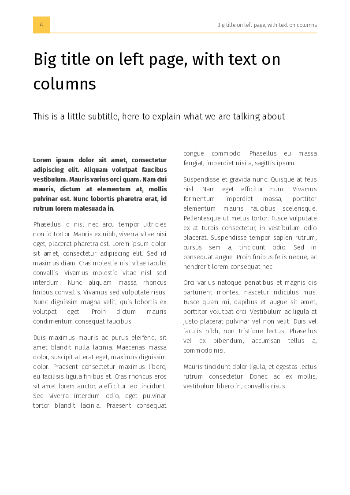
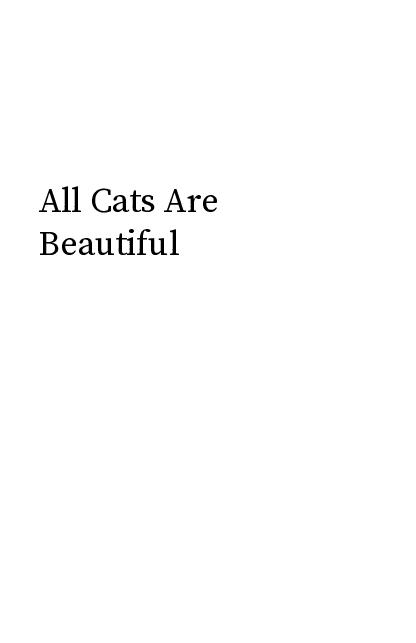
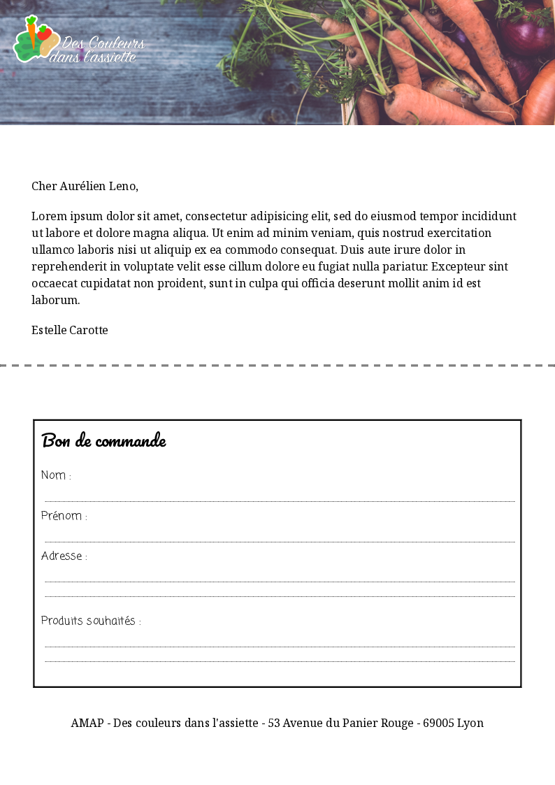
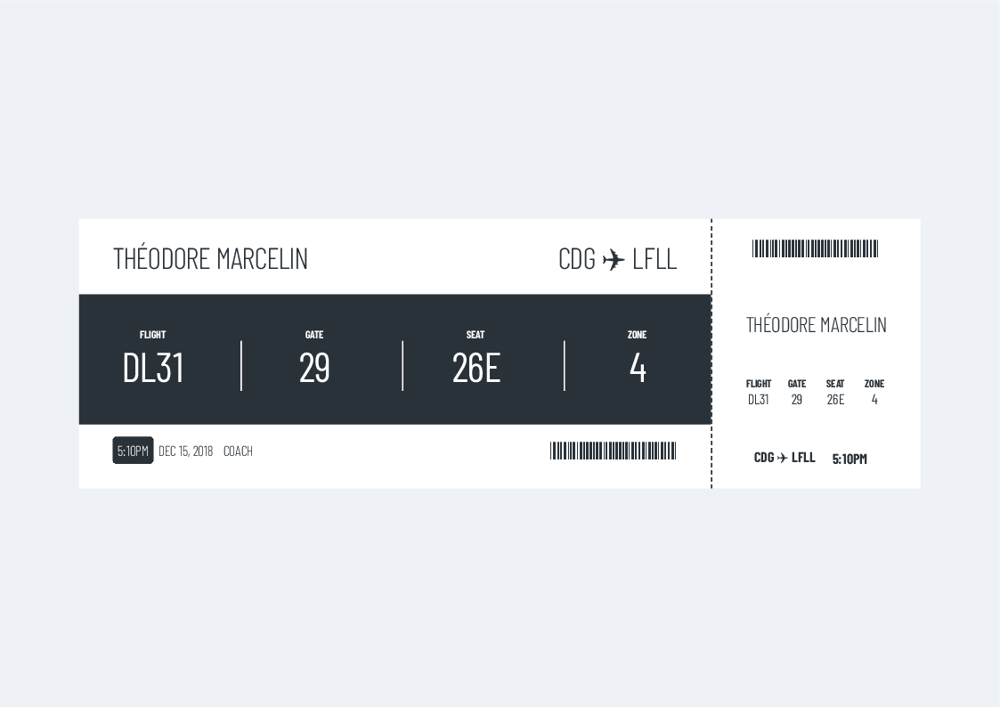

# weasyprint-ts: HTML to PDF in Node

Enjoy the versatility of **[WeasyPrint](https://github.com/Kozea/WeasyPrint)** without the Python or Chromium dependencies.

WeasyPrint is exceptionally good at making paged documents. It handles running headers, margin boxes, and page breaks, all while respecting the provided style sheet. The outputs are identical every time.

For a project that needs HTML-to-PDF in Node, you generally have three options:

- **Headless browser** (Puppeteer, Playwright, Paged.js): full browser just to make a PDF, with Chromium's layout.
- **The Python binary** (the `weasyprint` wrappers on npm): Python, Pango, HarfBuzz and FontConfig on every machine that runs your code.
- **Drawing libraries** (jsPDF, pdfmake, PDFKit): not HTML, or no layout engine at all.

This is the fourth option, a TypeScript port of WeasyPrint 70 that runs in plain Node with only five JavaScript dependencies (`fontkit`, `linebreak`, `parse5`, `fast-png`, `fflate`).

## Quick start

Try it without installing:

```sh
npx weasyprint-ts report.html report.pdf
```

Or install the command line tool globally:

```sh
npm install -g weasyprint-ts
```

Convert an HTML file to PDF:

```sh
weasyprint-ts report.html report.pdf
```

Add a stylesheet with `-s`:

```sh
weasyprint-ts -s style.css report.html report.pdf
```

Or add it to a project to use it as a library:

```sh
npm install weasyprint-ts
```

Then render from JavaScript:

```js
import { readFileSync } from 'node:fs';
import { HTML } from 'weasyprint-ts';
import { NodeFetcher, createFontConfiguration, defaultFontDirs } from 'weasyprint-ts/node';

const profile = new URL('../profiles/alpine_prod.json', import.meta.resolve('weasyprint-ts'));
const fontConfig = createFontConfiguration(defaultFontDirs(), JSON.parse(readFileSync(profile, 'utf8')));
const html = new HTML('<h1>Hello from Node.</h1>', { baseUrl: null, fetcher: new NodeFetcher() });
const pdf = await html.writePdf(null, 1, { fontConfig }); // Uint8Array
```

The full library example, CLI flags and font setup are below. The CLI handles the same options as `weasyprint`. Requires Node 20 or newer.

## Usage

```sh
weasyprint-ts [options] <input> <output>
```

Drop-in for the Python CLI's core surface:

| Flag | Meaning |
|---|---|
| `-s, --stylesheet` | user CSS stylesheet (repeatable) |
| `-u, --base-url` | base for relative URLs (default: the input's own location) |
| `-e, --encoding` | force input character encoding |
| `-m, --media-type` | media type for `@media` (default `print`) |
| `-p, --presentational-hints` | follow HTML presentational hints |
| `-v / -d / -q` | verbose / debug / quiet logging |
| `--uncompressed-pdf`, `--pdf-version` | PDF writer options |
| `-` | stdin/stdout |

Exit codes: `0` success, `1` load/render/write error, `2` usage error. Every upstream option is implemented (see `docs/option-parity.md`). `--hinting` and `-c/--cache-folder` are accepted without effect, and `-D/--dpi` matches except for JPEG (see *Known gaps*).

### As a library

Plain JavaScript, no TypeScript tooling required:

```js
import { readFileSync, writeFileSync } from 'node:fs';
import { HTML } from 'weasyprint-ts';
import { NodeFetcher, createFontConfiguration, defaultFontDirs } from 'weasyprint-ts/node';

// Fonts and URL bytes are the two IO seams; the Node entry supplies both.
// The shipped profile maps generic families the way the production image does.
const profile = new URL('../profiles/alpine_prod.json', import.meta.resolve('weasyprint-ts'));
const fontConfig = createFontConfiguration(defaultFontDirs(), JSON.parse(readFileSync(profile, 'utf8')));

const html = new HTML('<h1>Hello from the library.</h1>', {
  baseUrl: null,
  fetcher: new NodeFetcher(),
});

// Shortcuts mirroring the Python API:
const pdf = await html.writePdf(null, 1, { fontConfig });                 // Uint8Array
await html.writePdf('out.pdf', 1, { fontConfig, writeFile: writeFileSync });

// Or in two steps:
const doc = await html.render({ fontConfig });
const subset = doc.copy(doc.pages.filter((_, i) => i % 2 === 0));
writeFileSync('even.pdf', subset.writePdf());
```

TypeScript users get full declarations (`.d.ts` shipped), including the `TextEngine` seam and every option/type used above.

### Fonts

Fonts resolve like this:

1. `FONT_DIR` environment variable (colon-separated directory list), else
2. the platform's system font directories (macOS/Windows/Linux defaults).

The parity scripts set `FONT_DIR` explicitly so both engines see the same files.

A parsed font index is cached per directory in `.weasyprint-ts-font-index.json` (mtime/size-validated) to keep startup fast. Font files are never bundled or redistributed; see `NOTICE.md`.

## Does it match? Check with your own document

Left: Python WeasyPrint 70. Right: weasyprint-ts. This is page 4 of the official `report` sample, one of the samples shown on [weasyprint.org](https://weasyprint.org/). It has a running header, a page-number box and two justified columns. Both engines rendered the same input. The pixels are identical.

<p>
  
  
</p>

**First page of the [official samples](https://weasyprint.org/)**, WeasyPrint on the left and weasyprint-ts on the right. Click any image for the full-size render.

<table>
<tr><th></th><th>Python WeasyPrint 70</th><th>weasyprint-ts</th></tr>
<tr><td>Report</td><td><a href="examples/samples/report-python.png"></a></td><td><a href="examples/samples/report-typescript.png"></a></td></tr>
<tr><td>Book</td><td><a href="examples/samples/book-python.png"></a></td><td><a href="examples/samples/book-typescript.png"></a></td></tr>
<tr><td>Book (classical)</td><td><a href="examples/samples/book-classical-python.png"></a></td><td><a href="examples/samples/book-classical-typescript.png"></a></td></tr>
<tr><td>Letter</td><td><a href="examples/samples/letter-python.png"></a></td><td><a href="examples/samples/letter-typescript.png"></a></td></tr>
<tr><td>Ticket</td><td><a href="examples/samples/ticket-python.png"></a></td><td><a href="examples/samples/ticket-typescript.png"></a></td></tr>
<tr><td>Poster</td><td><a href="examples/samples/poster-python.png"></a></td><td><a href="examples/samples/poster-typescript.png"></a></td></tr>
<tr><td>Flyer</td><td><a href="examples/samples/flyer-python.png"></a></td><td><a href="examples/samples/flyer-typescript.png"></a></td></tr>
</table>

Try it on your own template. This renders it with both engines and shows the results side by side, with a pixel-diff badge:

```sh
python3 parity/side_by_side.py your-template.html --docker
```

Then open `sbs-your-template/side_by_side.html` in a browser. It is written next to your template.

Docker and Python are only needed for the reference side. Setup is under *Compare it yourself* below. If your document matches, you can drop Python. If it doesn't, please open an issue (see *Contributing*).

Every change is checked against 3,044 documents from upstream's test suite (five are excluded because upstream itself errors on them) and the eight official samples. None of the rest have differing pixels. That covers the basics: layout, text, tables and page breaks. It also covers the details that matter for precise output: page counts and sizes, PDF structure (metadata, links, bookmarks, PDF/A, tagged PDF), complex-script shaping and upstream's own quirks. One known exception: JPEGs downscaled with `--dpi` (see *Known gaps*).

**Good fit:** reports, books, tickets, letters, posters. Anything with page breaks, margin boxes, running headers, or tables that must split across pages.

**Not a fit:** pages that need JavaScript to run. WeasyPrint doesn't run scripts. Also anything that should match Chrome's screen rendering.

## Compare it yourself

The comparison above came from `parity/run_samples.py`. For a single document of your own, use the side-by-side script below.

Everything here compares against real Python WeasyPrint 70, not a recording. The oracle is a Docker image this repo builds (`parity/docker/alpine-prod-Dockerfile`): Alpine with Pango, HarfBuzz and a fixed font set, plus `weasyprint==70.0`. Both engines render the same file, Ghostscript rasterizes both PDFs at 96 dpi, and every pixel is compared.

Prerequisites: Node 22.18+, Python 3.10+, Docker, Ghostscript (`gs`), qpdf. On macOS that is `brew install python node ghostscript qpdf`, plus Docker Desktop.

```sh
git clone <this repo> && cd weasyprint-ts
npm ci

# Build the oracle once, a few minutes. The scripts below also do this for you
# if the image is missing.
docker build -t weasy-alpine-prod -f parity/docker/alpine-prod-Dockerfile parity/docker
```

**One document, side by side.** This renders `examples/flyer.html` with both engines, keeps both PDFs, rasterizes them, and writes a page with the renders next to each other and a pixel-diff badge:

```sh
python3 parity/side_by_side.py examples/flyer.html --docker
```

Open `examples/sbs-flyer/side_by_side.html` in a browser to see it.

The output also keeps the raw PDFs (`examples/sbs-flyer/flyer/python.pdf` and `typescript.pdf`), so you can open them in any viewer, run `pdftotext` on them, or diff them yourself.

**The repo corpus, with layout box trees:**

```sh
python3 parity/diffrun.py test/corpus --docker --layout
```

**The upstream test banks.** 3,044 documents, each rendered by both engines. Regenerating cases needs a checkout of upstream's own test suite; point `UPSTREAM_DIR` at it if it is not at `../reference_code/WeasyPrint`:

```sh
git clone --depth 1 --branch v70.0 https://github.com/Kozea/WeasyPrint ../reference_code/WeasyPrint
python3 parity/upstream_diff.py parity/upstream-cases --baseline parity/upstream-baseline.json
```

**The official samples plus the corpus, as one review page.** This is what the acceptance round renders:

```sh
python3 parity/acceptance.py --docker
```

Open `parity/acceptance-out/index.html` in a browser to see the result.

**The unit and corpus tests.** No Docker and no Python: the expected PDFs are committed.

```sh
npx tsc --noEmit
npm test
```

`parity/README.md` covers the rest: `--python-cmd` to use a local `pip install weasyprint==70.0` instead of Docker, `--no-font-pin`, per-document reports, the optional Paged.js column, and how fonts are pinned so a missing host font cannot fabricate a diff.

## Status

A case passes only when it is indistinguishable from the oracle: pixels, PDF structure, page counts. Anything else goes to the tracker.

| Area | State |
|---|---|
| HTML parsing, CSS cascade, computed styles | done (see *Known gaps* for what is not ported) |
| Layout: block, inline, tables, flex, floats, grid, columns, pagination | done |
| Absolute positioning, transforms, opacity, @page + margin boxes, string-set | done |
| Text: font matching, shaping, line breaking, hyphenation, soft hyphens, decorations | done (HarfBuzz normalization, script shapers, fallback marks) |
| Images: PNG, GIF, BMP, TIFF, WebP decode; JPEG decode (grayscale, RGB, CMYK/YCCK, every libjpeg subsampling, baseline and progressive) and Pillow-identical re-encode | done |
| Backgrounds, borders, shadows, gradients | done |
| Inline SVG, first-class (upstream SVG slices 0–11) | done |
| PDF variants, PDF/A · UA · X, tagged PDF, forms, attachments, bookmarks, links, page boxes/labels | done (structure 110/110: metadata/links/bookmarks/attachments/forms/tags, PDF/A 16, PDF/X 4) |
| CLI drop-in: `-s -a -p -e -m -u -D -j --pdf-variant …` | done, `--help` byte-identical |

## Coverage

Both are measured against the same pinned oracle, described in *What "matching WeasyPrint" takes* below.

**Official WeasyPrint samples** (`parity/run_samples.py`): all 8 documents grade **A** in every category (pages, fonts, palette, images, text, links, pixels).

**Upstream test cases** (`parity/upstream_diff.py`). The corpus currently holds 3,044 documents: 1,135 extracted from upstream's own suite inputs and 1,909 captured by *running* upstream's pytest suite in the oracle container (the tests build HTML dynamically, so the harness records what really gets rendered, including per-case options). A case passes when page count, page size and every pixel at 96 dpi match the oracle; the PDF-structure bank is compared separately by `parity/pdf_struct_diff.py`.

| Area | Matching | Cases |
|---|---|---|
| layout | 488 | 488 |
| draw | 511 | 511 |
| css | 63 | 63 |
| top-level (API, HTML, PDF) | 68 | 68 |
| **total** | **1130** | **1130** |

Five float-split cases are excluded because the oracle itself raises an exception on them (`parity/upstream-excluded.json`). The 1,909-case dynamic bank and the PDF-structure bank (110 cases) are also identical. The playbook is `parity/UPSTREAM_PLAYBOOK.md`; `parity/upstream-baseline.json` turns any new divergence into a named regression.

```sh
export UPSTREAM_DIR=../reference_code/WeasyPrint   # a v70.0 checkout
python3 parity/extract_upstream.py "$UPSTREAM_DIR/tests" parity/upstream-cases
python3 parity/upstream_diff.py parity/upstream-cases --baseline parity/upstream-baseline.json
```

## Known gaps

**Rendering.** The only known behavioural difference is JPEG + `--dpi`. Pillow asks libjpeg for a DCT-scaled decode (draft mode) before resizing, and the port decodes at full resolution and box-reduces. The result is a slightly different resample on downscaled JPEGs (sizes and colours match). Every other raster format is byte-exact. Tracked in `weasy-vej`.

**Not ported yet** (see `UPSTREAM.md`): colors outside sRGB (`lab()`, `oklch()`, `color()`), the `border-image` and `mask-border` shorthands, and part of the selector engine.

**API.** `render()` does not take `counter_style` or `color_profiles`, and there is no `finisher` callback. Some write options are CLI only. Details are in `docs/option-parity.md`.

**Text shaping** reproduces HarfBuzz 13.2.1 closely enough to be pixel-identical on the complex-script corpus (`parity/upstream-cases-shaping`, 17 documents covering a range of non-Latin scripts, combining marks and kerning). That rests on:

- HarfBuzz's normalizer: shortest canonical decomposition, mark reordering by the *modified* combining class, and recomposition from the canonical composition table including CompositionExclusions (`src/text/normalize.ts`);
- the script-specific shapers (for example jamo composition and vowel-sign reordering) and the right OpenType script tag per run;
- HarfBuzz's fallback mark positioning for fonts without GPOS (`src/text/fallback_marks.ts`), plus GDEF mark zeroing;
- FontConfig's per-family sort order for missing-glyph fallback, so a serif document picks the same fallback font Pango would;
- Pango's synthetic petite/small caps and unicase for faces without `pcap`/`smcp`/`unic`, and the hyphen that Pango counts at a soft hyphen.

The upstream test bank (static 1130 cases, dynamic 1909 cases) and the samples stay pixel-identical.

## Why not an existing JS/TS HTML→PDF library?

Everything in the JS/TS ecosystem that claims HTML→PDF falls into three families, and none of them contains WeasyPrint's layout arithmetic.

**Family 1: Python wrappers.** The packages named after WeasyPrint on npm (`weasyprint`, `node-weasyprint`, `weasyprint-wrapper`, `htmltopdf-weasyprint`) spawn the Python `weasyprint` binary as a subprocess and stream your HTML to it. All rendering lives in the Python process; the JS side is process management. They work exactly like whatever WeasyPrint their deployment provides, which is also their limit: every machine that runs your code needs Python, WeasyPrint, Pango, HarfBuzz and FontConfig installed, every document pays the interpreter startup, and nothing can be embedded, extended, or inspected from JavaScript. If you already operate Python WeasyPrint and only want a Node API around it, they are a reasonable choice.

**Family 2: browser rendering.** Puppeteer/Playwright (`page.pdf()`), Paged.js, `react-to-print`/`window.print()`, and the hosted APIs (pdfshift, api2pdf, …) all hand your HTML to Chromium. That is the whole set of real HTML renderers in JS/TS: one engine, and not WeasyPrint. We measured both variants on the comparison corpus (same pinned production fonts) with the raster-compare harness:

| Engine | Differing pixels vs WeasyPrint 70 |
|---|---|
| Chromium native print | 11–13% |
| Paged.js (polyfill, unmodified) | 14–19% |
| Paged.js + quirk shims (filter drop, `@page :not(:first)` strip, oracle-measured table columns, per-block position calibration) | 8.8–14.6% |
| **weasyprint-ts** | **0%** |

Reproduce the contender panes with `python3 parity/side_by_side.py DOC.html --pagedjs` (the runner is `parity/pagedjs/render_pagedjs.mjs`; install it with `cd parity/pagedjs && npm install`). The calibrated row uses `CALIBRATE=<oracle box dump>`.

The residual for Chromium/Paged.js is structural, not cosmetic: line-box rounding, table auto-layout distribution, flex heights, and page fragmentation all differ, so long documents even paginate to a different page count (3 vs 4 on the multipage corpus document). Paged.js also honors `@page :not(:first)`, which WeasyPrint 70 ignores, so a document that depends on that quirk cannot render identically in a spec-correct engine.

**Family 3: libraries whose "HTML→PDF" doesn't run an HTML layout engine:**

| Library | What it actually does | Verdict for WeasyPrint-parity |
|---|---|---|
| jsPDF (`.html()`) | Drives html2canvas's DOM walk through its own canvas shim, emitting drawing commands. An approximation of a rendering pass: no z-order, partial CSS, version-dependent text handling | ❌ no layout engine |
| html2pdf.js | html2canvas + jsPDF: genuine raster screenshots | ❌ image of the page, no text |
| pdfmake | Its own JSON document DSL on PDFKit; you rewrite your generator to target it | ❌ not HTML |
| PDFKit | Programmatic drawing API (fontkit-based) | ❌ no HTML |
| @react-pdf/renderer | React components → Yoga flexbox, no CSS cascade | ❌ not HTML |
| pdf-lib | Editor for existing PDFs (merge/forms/stamp) | ❌ different problem |
| Nutrient (PSPDFKit) | Commercial viewer/editor SDK | ❌ different problem + license |

Family 1 needs the Python stack on every machine. Family 2 is one engine that computes layout differently by design: spec-correct where WeasyPrint is quirky. Family 3 assumes the layout problem away by having you compute positions. Matching WeasyPrint therefore requires WeasyPrint's own layout arithmetic, which exists in one place: WeasyPrint. This project is that arithmetic, in TypeScript.

## Architecture

Modules mirror upstream file-by-file (each docstring names the file it mirrors, e.g. `mirrors weasyprint/layout/block.py`; see `UPSTREAM.md`):

```
src/
├── css/                  # tokenizer, parser, selectors, cascade, computed values
├── formatting_structure/ # box tree construction (build.ts, boxes.ts)
├── layout/               # block/inline/table/flex/grid/page/absolute/float
├── draw/                 # box drawing onto the PDF stream
├── pdf/                  # pydyf-equivalent writer, fonts, subsetting, anchors
├── text/                 # the text engine (shaping, line breaking, metrics)
├── dom.ts, document.ts   # DOM model, render/paint entry points
└── cli/                  # ⚠ the ONLY Node-dependent layer (fs/net adapters)
```

Design rules, enforced where practical:

- **Runtime-agnostic core**: `src/` outside `src/cli/` must not import `node:*` (or use Node globals). All IO goes through the `Fetcher`, `FontSource` and log-sink interfaces. Enforced by `test/runtime_agnostic.test.ts`. This keeps browser/Deno builds possible.
- **Synchronous core**, like upstream: async IO is prefetched, then layout runs synchronously.
- **Parity over elegance**: where upstream has quirks (WeasyPrint 70 ignores `@page :not(:first)`; `filter:` is unsupported and dropped with a warning; float-vs-int formatting in content streams), the port replicates the quirk. Pixel-identical means bug-identical.
- Style keys stay snake_case (`style.get('margin_top')`), box attributes are camelCase (`box.marginTop`), matching upstream naming.

### The TextEngine seam

All font matching, shaping, line breaking and metrics go through one interface (`src/text/engine.ts`):

```ts
interface TextEngine {
  matchFont(...); shape(...); breakOpportunities(...);
  firstLine(...); createLayout(...); metrics { ... };
}
getTextEngine();          // active engine (fontkit + linebreak default)
setTextEngine(engine);    // swap a backend without touching layout code
```

Layout code never imports fontkit directly. The default backend reproduces Pango/HarfBuzz behaviour (normalization, script shapers, fallback marks, synthetic caps); the seam stays open for alternative backends.

## What "matching WeasyPrint" takes, concretely

This section is the short version of `parity/UPSTREAM_PLAYBOOK.md`. It is worth 10 minutes if you want to see what day-to-day parity work is made of:

- **The oracle.** Every comparison renders the document twice: once with this port, once with real Python WeasyPrint 70 running in a Docker image with pinned Pango/HarfBuzz/fontconfig/versions (`weasy-alpine-prod`). The oracle is never approximated: every check renders the document with real WeasyPrint.
- **The harnesses.** `parity/diffrun.py` compares a corpus (page counts, pixel rasters, and layout box trees with `--layout`). `parity/upstream_diff.py` scores the upstream banks. `parity/pdf_struct_diff.py` compares PDF objects item by item. `parity/side_by_side.py` gives a human view for any document.
- **What gets compared**, for every case: page count, page size, the laid-out box tree (0.01 px coordinate tolerance in the layout diff, 0 in pixels), every 96-dpi pixel, PDF object dictionaries (metadata, links, bookmarks, attachments, embedded-file checksums/dates), and extracted text.
- **The corpus.** Static extracts (upstream's input strings) plus dynamic captures: upstream's pytest suite runs *inside* the container with a shim that records the actual HTML and the per-case options, so the comparison starts from exactly what upstream renders, not from a re-writing of it.
- **Probing.** When engines disagree, the oracle gets interrogated: fc-match under the pinned fontconfig, Pango/Cairo flags, font-table dumps. The replication has to match the *behavior*, whatever the internal reason (many of the fixes in this repo reproduce upstream quirks like float-vs-int coordinate formatting in PDF streams).
- **The bookkeeping.** Beads issue tracker (`br`): every gap, fix and regression is a ticket with its evidence chain; `parity/upstream-baseline.json` turns any new divergence into an instant, named regression.

## Development

Running from a checkout executes the TypeScript source directly, which needs Node 22.18+ (native type stripping, no build step). CI runs Node 26.

```sh
npx tsc --noEmit     # typecheck (strict)
npm test             # node:test suite incl. runtime-agnostic guard
node tools/render.ts in.html out.pdf      # render without the CLI arg parsing
node tools/layout_dump.ts in.html         # dump the laid-out box tree as JSON
node tools/box_dump.ts in.html            # dump the pre-layout box tree
```

## Contributing

Contributions welcome: code, tests, and parity reports (documents that render differently are gold; open an issue with the HTML + expected output).

Ground rules:

1. **Parity is the spec.** When in doubt, check what WeasyPrint 70 does (`UPSTREAM.md` tracks the upstream checkout) and replicate the behavior, including its bugs. If upstream changes behavior in a newer version, that's a versioned change, not a fix.
2. **Keep the core runtime-agnostic**: no `node:*` imports outside `src/cli/`; the test suite enforces it.
3. **Keep modules mirroring upstream**: one docstring line naming the upstream file per module; behavior changes reference upstream commits.
4. **Tests**: `npx tsc --noEmit` and `npm test` must pass; layout changes should include a document that exercises them (the comparison harness pixel-compares against the reference automatically).
5. **Never commit fonts** (see `NOTICE.md`).

## Thanks

This project would not be possible without WeasyPrint. The port follows [WeasyPrint 70](https://github.com/Kozea/WeasyPrint) closely, and the bar it sets is unusually high: a complete CSS paged-media implementation, a precise PDF writer, and a test suite detailed enough that a from-scratch port can be checked against it pixel by pixel. That is what makes "zero differing pixels" a target worth aiming at, and most of the credit for the hard part belongs to WeasyPrint's authors and contributors.

The runtime also leans on fontkit, linebreak, parse5, fast-png and fflate; thanks to their maintainers as well.

## License

This port is BSD-3-Clause; see `LICENSE`. It is the same license upstream WeasyPrint itself uses; its attribution is preserved in `NOTICE.md`. No LGPL/Pango code is translated: the text stack is a clean-room reimplementation from documented behaviour, verified pixel-identical against upstream on a corpus of complex-script documents.
